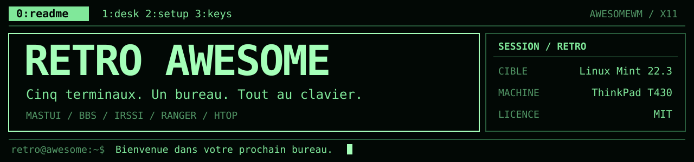
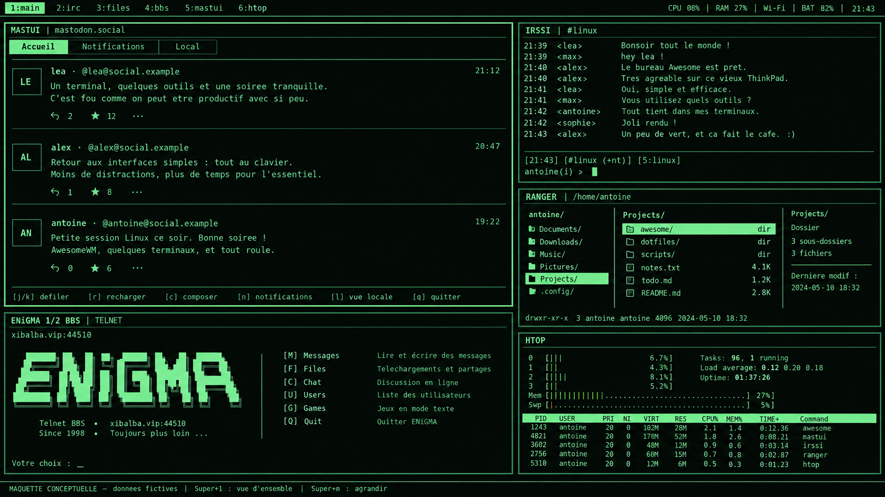

# 

<p align="center">
  <samp>Une session X11 dédiée, inspirée des interfaces de terminal rétro.</samp>
</p>

<p align="center">
  <a href="#le-projet"><code>1:projet</code></a> ·
  <a href="#installation"><code>2:installation</code></a> ·
  <a href="docs/configuration.md"><code>3:configuration</code></a> ·
  <a href="#utilisation"><code>4:raccourcis</code></a> ·
  <a href="#documentation"><code>5:docs</code></a> ·
  <a href="#licence"><code>6:licence</code></a>
</p>

<p align="center">
  <a href="references/maquette-bureau.png">
    
  </a>
  <br>
  <samp>VUE D'ENSEMBLE / MAQUETTE CONCEPTUELLE</samp><br>
  <sub>Données fictives · Cliquer pour agrandir · Captures réelles à venir</sub>
</p>

> **`STATUT` — Implémentation initiale.** Des tests locaux couvrent la
> configuration, l'installateur et la géométrie des fenêtres. L'installation
> sous Linux Mint, le rendu graphique, les connexions et le matériel restent
> à valider sur le T430. Voir le [compte rendu de qualification](docs/qualification.md).

<a name="le-projet"></a>

## 

Retro Awesome réunit cinq applications dans une session X11 dédiée. Chaque
outil s'exécute dans son propre terminal **xterm**, avec une palette commune,
une police monospace et des bordures fines.

| Outil | Usage |
| --- | --- |
| `Mastui` | Lire les fils Mastodon, consulter les notifications et publier. |
| `BBS Telnet` | Se connecter au BBS de son choix, avec prise en charge d'UTF-8 et de CP437. |
| `Irssi` | Rejoindre ses réseaux et salons IRC, avec TLS activé par défaut. |
| `ranger` | Parcourir et gérer ses fichiers au clavier. |
| `htop` | Suivre les processus, le CPU et la mémoire de la machine. |

- **Vue d'ensemble et vues dédiées** : agrandir un outil, puis revenir aux cinq panneaux en conservant ses connexions.
- **Disposition adaptative** : deux ou trois colonnes selon la surface disponible, la police et le DPI.
- **Intégration au portable** : barre d'état, réseau, batterie, volume, réglages d'affichage et verrouillage.
- **Session indépendante** : réutilisation d'AwesomeWM existant et conservation de sa configuration personnelle ; Xfce reste accessible.
- **Installation suivie** : diagnostic, plan avant confirmation, sauvegardes, récupération et désinstallation des fichiers gérés.

<a name="prérequis"></a>

## 

| Élément | Cible de l'installateur |
| --- | --- |
| Système | **Linux Mint 22.3**, base Ubuntu **Noble**, déjà installé. |
| Architecture | **x86_64** ; matériel de référence : **ThinkPad T430**. |
| Affichage | **X11**, avec un gestionnaire de connexion proposant les sessions X. |
| Gestionnaire de fenêtres | **AwesomeWM 4.3 ou version 4.x ultérieure**. Une installation existante est réutilisée. |
| Installation | Python 3, accès Internet aux dépôts APT et à PyPI, et droits `sudo` pour les opérations système. |

L'installateur détecte la RAM, les écrans et le GPU. Il demande les paquets
manquants à APT avec `--no-upgrade` ; une version incompatible d'Awesome est
signalée avant modification. Mastui **1.14.2** est installé dans un
environnement pipx dédié, après vérification du SHA-256 de son archive source.

L'installation est limitée à cette cible. Les commandes `diagnose`, `plan`
et `check` peuvent aussi être utilisées sur la machine de développement.

<a name="installation"></a>

## 

Télécharger ou cloner le dépôt, puis ouvrir un terminal à sa racine sur le T430,
depuis la session Linux Mint habituelle.

### 1. Préparer les paramètres

```sh
nano config/settings.ini
```

Les valeurs fournies permettent un premier essai :

| Service | Comportement initial |
| --- | --- |
| BBS | Connexion manuelle à `xibalba.vip:44510`, en UTF-8. |
| IRC | Aucun serveur ni salon configuré ; Irssi démarre hors ligne. |
| Mastodon | Ouverture de Mastui, instance `https://mastodon.social`, autorisation du compte au premier lancement, médias désactivés. |

Le [guide de configuration](docs/configuration.md) détaille chaque paramètre,
avec des exemples pour le BBS, IRC, Mastodon et l'apparence du bureau.
**Les mots de passe et jetons se configurent dans les applications, jamais
dans `settings.ini`.** Telnet transmet en clair : utiliser un mot de passe
propre au BBS.

### 2. Vérifier et installer

```sh
./install.sh diagnose
./install.sh plan
./install.sh install
./install.sh verify
```

Exécuter ces commandes avec le compte habituel, **sans `sudo` devant le
script**. L'installateur présente son plan et demande confirmation. Il
sollicite `sudo` pour APT et les deux fichiers système de la nouvelle session.
La commande `verify` effectue des contrôles locaux ; les essais graphiques
font l'objet d'une [recette distincte](docs/recette-t430.md).

À la première installation, les préférences sont copiées dans
`~/.config/retro-awesome/settings.ini`. **Si ce fichier existe déjà, ses
valeurs sont conservées et priment sur le modèle du dépôt.**

### 3. Ouvrir la session

Se déconnecter, puis sélectionner **Retro Awesome (identifiant numérique du
compte)** dans le gestionnaire de connexion. Les cinq panneaux s'ouvrent ;
les connexions BBS et IRC ne démarrent automatiquement que si leur option
`autoconnect` a été activée.

Pour autoriser Mastodon, utiliser <kbd>Super+5</kbd> afin d'agrandir Mastui. Son
assistant fournit un lien « Get Auth Link » à ouvrir dans un navigateur ;
le code obtenu se recopie dans Mastui. Les prochains lancements réutilisent
le profil enregistré.

<details>
<summary>Options d'installation et fichiers créés</summary>

```sh
./install.sh install --yes            # Accepter le plan sans nouvelle question
./install.sh install --skip-packages  # Vérifier les dépendances déjà présentes, sans APT/pipx
```

| Emplacement par défaut | Contenu |
| --- | --- |
| `~/.config/retro-awesome/` | Préférences et configurations de la session. |
| `~/.local/share/retro-awesome/` | Lanceurs, bibliothèques et environnement pipx dédié. |
| `~/.local/state/retro-awesome/` | Manifeste, diagnostic, versions, journal de transaction et sauvegardes. |
| `/usr/local/bin/retro-awesome-<uid>` | Lanceur réservé au compte concerné. |
| `/usr/share/xsessions/retro-awesome-<uid>.desktop` | Entrée du gestionnaire de connexion. |

Les chemins utilisateur respectent `XDG_CONFIG_HOME`, `XDG_DATA_HOME` et
`XDG_STATE_HOME` lorsqu'ils sont définis. Les configurations Awesome et Xfce
préexistantes sont conservées.

</details>

<a name="utilisation"></a>

## 

**Super** désigne la touche Windows. Sur un clavier AZERTY, les vues utilisent
les positions de la rangée supérieure : <kbd>Super+&amp;</kbd> ouvre la vue 1,
<kbd>Super+é</kbd> la vue 2, sans Majuscule. Les vues et fenêtres sont également
accessibles à la souris ou au TrackPoint.

| Raccourci | Action |
| --- | --- |
| <kbd>Super+1</kbd> | Vue d'ensemble des cinq outils. |
| <kbd>Super+2 / 3 / 4 / 5 / 6</kbd> | Irssi / ranger / BBS / Mastui / htop. |
| <kbd>Super+7</kbd> | Terminaux libres et autres applications. |
| <kbd>Super+Entrée</kbd> | Ouvrir un terminal libre. |
| <kbd>Super+m</kbd> | Agrandir ou restaurer la fenêtre active. |
| <kbd>Super+j / k</kbd> | Sélectionner la fenêtre suivante / précédente. |
| <kbd>Super+s</kbd> | Afficher l'aide des raccourcis. |
| <kbd>Super+l</kbd> | Verrouiller la session. |
| <kbd>Super+p</kbd> | Ouvrir les réglages d'affichage Xfce. |
| <kbd>Super+Ctrl+r</kbd> | Valider les paramètres et recharger Awesome. |
| <kbd>Super+Maj+r</kbd> | Rouvrir les outils fermés. |
| <kbd>Super+Maj+c</kbd> | Fermer la fenêtre active. |
| <kbd>Super+Maj+q</kbd> | Ouvrir le menu de fin de session. |
| <kbd>Super+Ctrl+o</kbd> | Déplacer la fenêtre vers un autre écran. |
| <kbd>Super+Maj+1…7</kbd> | Déplacer la fenêtre vers une autre vue. |

Les vues dédiées utilisent les mêmes fenêtres que la vue d'ensemble : changer
de vue conserve les applications et leurs connexions. <kbd>Super+Maj+r</kbd> rouvre
les outils fermés sans relancer ceux qui sont encore présents.

### Personnaliser le bureau

Après installation, modifier le fichier personnel :

```sh
nano ~/.config/retro-awesome/settings.ini
```

Il regroupe les couleurs, la police, les espacements, les widgets et les
paramètres de connexion. La disposition accepte `auto`, `compact` ou `wide` ;
la police commence à 10 points et reste réglable à partir de 9 points.

<kbd>Super+Ctrl+r</kbd> applique les réglages du bureau. La police et les couleurs
des terminaux ainsi que certains paramètres applicatifs prennent effet au
prochain lancement du panneau concerné. Le [guide de configuration](docs/configuration.md#après-linstallation)
précise les cas et la procédure de réouverture.

<a name="désinstallation-et-récupération"></a>

## 

Revenir à Xfce ou à la session Awesome habituelle, puis exécuter :

```sh
./install.sh uninstall
```

Le retrait restaure les fichiers préexistants suivis par le manifeste et
sauvegarde les modifications locales des fichiers gérés. Les préférences,
profils, comptes, caches, paquets et l'environnement pipx sont conservés.

Une transaction interrompue est récupérée avant la prochaine installation,
ou explicitement avec :

```sh
./install.sh recover
```

Le suivi se trouve dans `~/.local/state/retro-awesome/` : `manifest.json`,
`diagnostic.json`, `versions.json`, `transaction.json`, `backups/` et
`last-error.log` en cas d'échec. La récupération porte sur les fichiers gérés ;
les opérations APT et pipx ne sont pas annulées. Les détails d'erreur APT
restent disponibles dans sa sortie et dans `/var/log/apt/term.log`.

<a name="développement-et-contributions"></a>

## 

Les vérifications locales nécessitent **Python 3**, **Lua**, **luac** et **make** :

```sh
make check  # Vérifier les syntaxes Python, shell et Lua des fichiers à installer
make test   # Exécuter aussi les tests Python et les cas de géométrie Lua
```

Sous Mint, l'installateur utilise également `awesome -k` avant l'activation de
la configuration. Les tests locaux sont complétés par la
[procédure de recette sur le T430](docs/recette-t430.md), qui couvre les
connexions, le rendu, les périphériques, le verrouillage et la reprise de veille.

Pour proposer une amélioration, ouvrir une issue ou une pull request avec
le contexte, le comportement attendu et les vérifications effectuées. Pour
un problème d'affichage, préciser la résolution, le DPI et la taille de police.

```text
.
├── config/         # Configuration Awesome et thèmes des applications
├── docs/           # Guides, qualification et visuels SVG du README
├── payload/        # Lanceurs de session et bibliothèques d'exécution
├── references/     # Photographies et maquette de conception
├── tests/          # Tests Python et géométrie Lua
├── install.sh      # Point d'entrée de l'installateur
├── installer.py    # Installation, vérification, récupération et retrait
├── Makefile        # Vérifications locales
└── LICENSE         # Licence MIT
```

<a name="documentation"></a>

## 

| Document | Contenu |
| --- | --- |
| [Configuration](docs/configuration.md) | Tous les paramètres, exemples de connexion et prise en compte des modifications. |
| [Références visuelles](docs/references-visuelles.md) | Palette, typographie et choix de disposition. |
| [Qualification](docs/qualification.md) | Vérifications réalisées, limites et essais restants. |
| [Recette T430](docs/recette-t430.md) | Procédure de validation sur la machine cible. |
| [Spécification fonctionnelle](Specification-fonctionnelle-Retro-Awesome-Mint.md) | Objectifs, usages et critères de recette. |
| [Spécification technique](Specification-technique-Retro-Awesome-Mint.md) | Architecture et décisions de conception. |

<a name="licence"></a>

## 

Ce projet est distribué sous [licence MIT](LICENSE).
Les logiciels tiers utilisés conservent leurs licences respectives.

---

<p align="center">
  <samp>retro@awesome:~$ <a href="#">retour en haut</a> ▌</samp>
</p>
